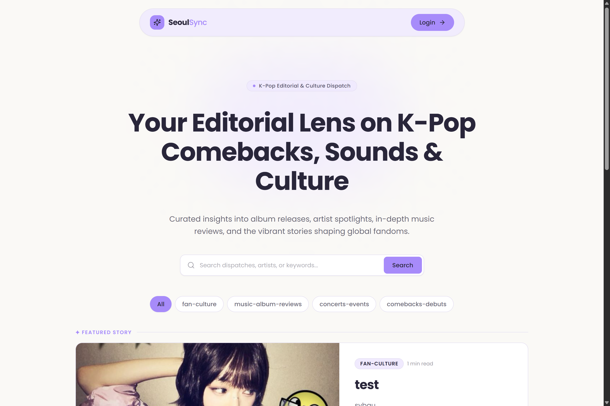
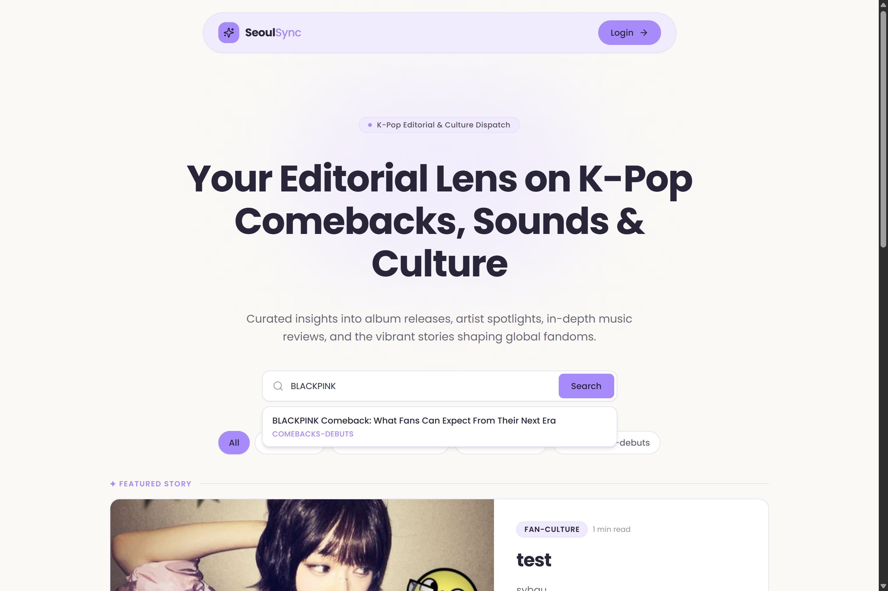
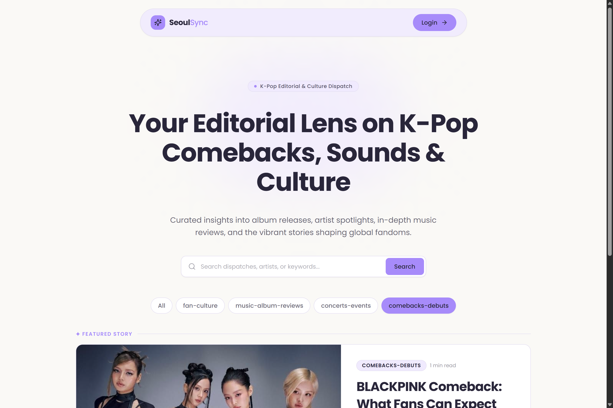
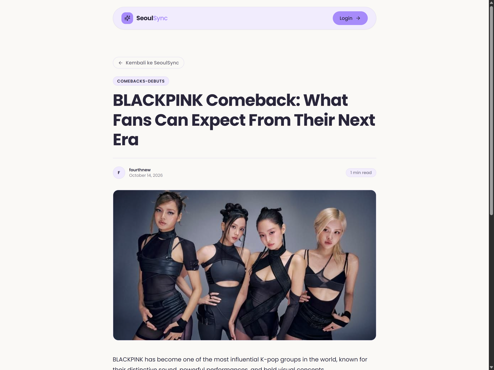
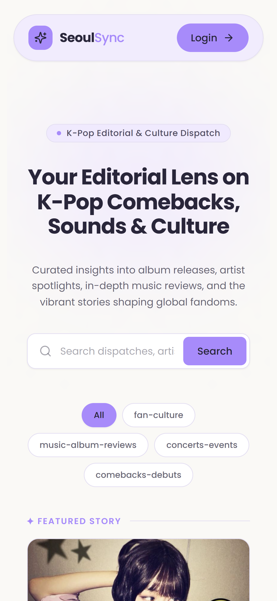
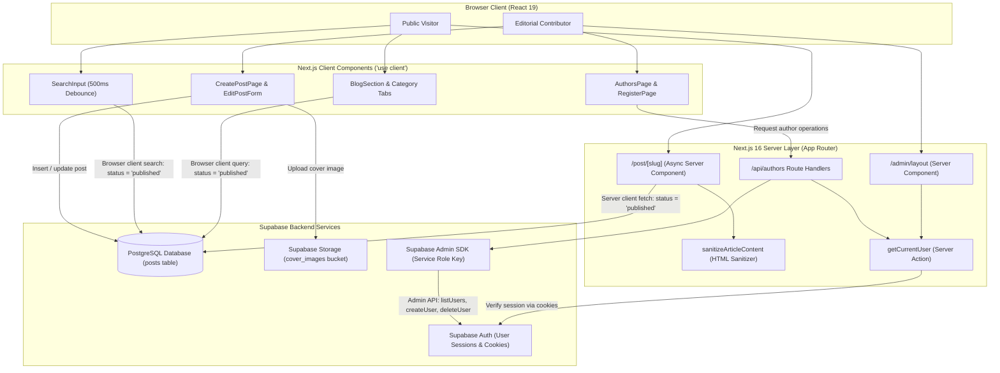

# SeoulSync ✦ K-Pop Editorial & Culture Dispatch

[](https://nextjs.org/)
[](https://react.dev/)
[](https://www.typescriptlang.org/)
[](https://tailwindcss.com/)
[](https://supabase.com/)
[](https://seoulsync-iota.vercel.app/)

> **SeoulSync** is a modern editorial publishing web application dedicated to K-Pop comebacks, album reviews, concert dispatches, and fandom culture. Built with Next.js 16 (App Router), React 19, and Supabase, it pairs an engaging reader experience with an administrative content management system.

---

## 🌐 Live Demo & Repository

- **Live Production URL:** [https://seoulsync-iota.vercel.app/](https://seoulsync-iota.vercel.app/)
- **GitHub Repository:** [https://github.com/zachrrd/seoulsync](https://github.com/zachrrd/seoulsync)

---

## 📸 Application Showcase

Real screenshots captured directly from the live deployed application.

### 1. Editorial Homepage & Featured Spotlight
The primary landing view showcases curated K-pop journalism, featuring dynamic hero branding, live category filters, an editorial spotlight dispatch, and a grid of recent articles.



### 2. Live Debounced Search
An instant search interface with a 500ms debounce that queries published articles by title and keywords in real time, presenting immediate preview cards.



### 3. Dynamic Category Filtering
Readers can seamlessly filter dispatches across specific beats—including *Comebacks & Debuts*, *Music & Album Reviews*, *Concerts & Events*, and *Fan Culture*—with zero page reloads.



### 4. Article Detail & Typography Experience
Server-rendered article pages featuring dynamic OpenGraph SEO metadata, estimated reading time, author attribution, cover imagery, and sanitized rich typography.



### 5. Responsive Mobile Experience
A mobile-optimized layout delivering touch-friendly navigation, adaptive card grids, and readable editorial typography across handheld viewports.



> [!NOTE]
> **Admin Dashboard & Editor Views:**
> Access to `/admin`, post authoring, and author management routes requires an authenticated session via Supabase Auth. Unauthenticated visitors are automatically redirected to `/login`. In accordance with security practices, production credentials are not bypassed or exposed for documentation.

---

## ✨ Features

### Reader-Facing Experience
- **Editorial Spotlight & Grid:** Automatically spotlights the most recent published story in a featured hero layout, accompanied by a responsive card grid for remaining articles.
- **Dynamic Category Filtering:** Client-side category switching derived from active post metadata (`comebacks-debuts`, `music-album-reviews`, `concerts-events`, `fan-culture`).
- **Real-Time Debounced Search:** Search input utilizing a 500ms debounce to query published article titles and keywords via Supabase.
- **Server-Rendered Article Pages:** Dynamic Server Component rendering (`src/app/post/[slug]/page.tsx`) ensuring fast initial paint and search engine indexing.
- **Dynamic OpenGraph & Twitter Card SEO:** Custom `generateMetadata` implementation producing tailored article metadata, titles, descriptions, and social preview cards.
- **HTML Content Sanitization:** Security pipeline powered by `sanitize-html` to whitelist permitted tags, enforce secure hyperlink attributes (`rel="noopener noreferrer"`, `target="_blank"`), and inject `loading="lazy"` on images.
- **Reading Time Estimation:** Automatic calculation of article read time derived from plain-text word count (200 words per minute baseline).
- **Loading Skeleton Placeholders:** Dedicated skeleton layouts (`PostCardSkeleton`, `PostSkeleton`) providing visual feedback during asynchronous data hydration.

### Editorial & CMS Administration
- **Session-Based Authentication:** Cookie-backed session verification powered by `@supabase/ssr` with email and password credentials.
- **Route Guarding:** Server-side route protection across all `/admin/*` views utilizing the `getCurrentUser()` server action.
- **Article Inventory & Management:** Overview of published and drafted articles with quick deletion controls.
- **WYSIWYG Rich Text Editor:** In-browser article composition and formatting powered by Jodit Editor.
- **Cover Image Storage Integration:** Direct image asset upload to the Supabase Storage `cover_images` bucket, generating public CDN URLs for publication.
- **Automatic Slug Generation:** Dynamic URL slug creation using `slugify` based on article headlines.
- **Author Administration:** Management interface to invite and register new editorial contributors or remove accounts using the Supabase Admin API.

---

## 🛠️ Technology Stack

| Layer | Technology | Version | Description |
| :--- | :--- | :--- | :--- |
| **Framework** | [Next.js](https://nextjs.org/) | `16.4.0` | React framework using App Router, Server Components, and Turbopack |
| **UI Library** | [React](https://react.dev/) | `19.3.0` | Core UI library with React Server Components |
| **Language** | [TypeScript](https://www.typescriptlang.org/) | `5.9.3` | Static typing and interfaces across components, hooks, and APIs |
| **Styling** | [Tailwind CSS](https://tailwindcss.com/) | `4.3.3` | Modern utility-first styling with `@tailwindcss/turbopack` |
| **Backend & DB** | [Supabase](https://supabase.com/) | Cloud | PostgreSQL database, Supabase Auth, and Storage service |
| **Supabase SSR** | [@supabase/ssr](https://github.com/supabase/auth-helpers) | `0.12.7` | Cookie-based session management for Server Components and Route Handlers |
| **Supabase Client** | [@supabase/supabase-js](https://supabase.com/docs/reference/javascript) | `2.117.3` | Supabase JavaScript client and privileged service-role admin SDK |
| **Rich Text Editor** | [jodit-react](https://xdsoft.net/jodit/) | `5.7.3` | WYSIWYG text editor for editorial authoring |
| **HTML Sanitizer** | [sanitize-html](https://github.com/apostrophecms/sanitize-html) | `2.18.0` | HTML sanitization whitelisting safe tags, attributes, and URI schemes |
| **Icon Suite** | [react-icons](https://react-icons.github.io/react-icons/) | `5.7.0` | Comprehensive icon library utilizing Lucide (`react-icons/lu`), Feather (`react-icons/fi`), and BoxIcons (`react-icons/bi`) |
| **Notifications** | [react-hot-toast](https://react-hot-toast.com/) | `2.6.1` | Lightweight toast notifications for user actions |
| **String Utilities** | [slugify](https://github.com/simov/slugify) | `1.6.9` | URL slug generation from post titles |
| **Typography** | `next/font` | Built-in | Google Fonts integration loading Poppins (`300`–`800` weights) |
| **Deployment** | [Vercel](https://vercel.com/) | Production | Edge caching, serverless execution, and automated deployments |

---

## 🏗️ System Architecture



---

## 🔒 Security & Access Control

SeoulSync implements access control and defensive data handling across client, server, and storage layers:

### 1. Authentication vs. Authorization
- **Authentication:** Verified via `supabase.auth.getUser()`, which validates session tokens stored in HTTP-only cookies on both the server (`getCurrentUser()` server action) and the client (`LoginPage`).
- **Authorization:** Protected routes under `/admin/*` enforce authentication checks—any user with an active Supabase account can access the editorial dashboard. Explicit role-based access control (RBAC) is not implemented in the current application layer. Account self-deletion is prevented at the API layer (`/api/authors/[id]`).

### 2. Query Filtering & Database Security
- **Application Filtering:** Public-facing queries (`BlogSection`, `SearchInput`, and `PostPage`) explicitly filter records using `.eq("status", "published")`, ensuring drafts remain isolated.
- **Row Level Security (RLS):** Database policies are managed directly in Supabase to regulate table access. Public access is restricted to reading published rows, while mutations require authenticated user tokens.
- **Service Role Key Isolation:** Privileged administrative actions (listing all registered users, programmatic author registration, author account deletion) are executed strictly on the server in `/api/authors` using `SUPABASE_SERVICE_ROLE_KEY`. This key is never included in client JavaScript bundles.

### 3. HTML Sanitization Pipeline
- Rich-text HTML content authored via the Jodit editor is processed through `sanitizeArticleContent()` before rendering.
- Dangerous elements (`<script>`, `<iframe>`, inline event handlers) and invalid URI schemes (`javascript:`, `data:`) are stripped.
- Hyperlinks targeting external destinations are sanitized to include `rel="noopener noreferrer"` and `target="_blank"`.
- Images are automatically augmented with `loading="lazy"` attributes.

---

## 📁 Project Structure

The project uses Next.js App Router within the `src/` directory:

```text
nextblog/
├── public/
│   ├── images/
│   │   ├── readme/                  # Verified screenshots of deployed site
│   │   │   ├── article-detail.png
│   │   │   ├── category-filter.png
│   │   │   ├── homepage.png
│   │   │   ├── mobile-view.png
│   │   │   └── search-results.png
│   │   └── avatar.png
│   ├── file.svg
│   ├── globe.svg
│   ├── next.svg
│   ├── vercel.svg
│   └── window.svg
├── src/
│   ├── app/
│   │   ├── admin/                   # Protected editorial CMS
│   │   │   ├── authors/             # Staff & author management view
│   │   │   ├── create-post/         # Rich-text post creation page
│   │   │   ├── posts/               # Post inventory & management
│   │   │   │   └── [postId]/        # Dynamic post edit view
│   │   │   ├── register/            # New author registration form
│   │   │   ├── layout.tsx           # Guarded admin layout with persistent sidebar
│   │   │   └── page.tsx             # Admin dashboard with stats and recent posts
│   │   ├── api/
│   │   │   └── authors/             # Privileged backend API routes
│   │   │       ├── [id]/route.ts    # Author deletion handler
│   │   │       └── route.ts         # Author list and creation handler
│   │   ├── login/
│   │   │   └── page.tsx             # Author login route
│   │   ├── post/
│   │   │   └── [slug]/
│   │   │       └── page.tsx         # Dynamic SSR article detail page & metadata
│   │   ├── server-actions/
│   │   │   └── getCurrentUser.ts    # Session verification server action
│   │   ├── globals.css              # Global styling & Tailwind v4 theme tokens
│   │   ├── icon.png                 # App icon
│   │   ├── layout.tsx               # Root layout with font and toaster configuration
│   │   └── page.tsx                 # Public landing page
│   ├── components/
│   │   ├── admin/                   # DashboardStats, EditPostForm, RecentPosts, Sidebar
│   │   ├── general/                 # BackButton, Footer
│   │   ├── home/                    # BlogSection, SearchInput
│   │   ├── layouts/                 # ContainerLayout
│   │   ├── loading/
│   │   │   └── skeletons/           # PostCardSkeleton, PostSkeleton
│   │   ├── login/                   # LoginComponent
│   │   └── navbar/                  # Logo, Navbar
│   ├── custom-hooks/
│   │   └── usePost.ts               # Post interface and usePosts data hook
│   └── lib/
│       ├── sanitize.ts              # sanitize-html XSS defense configuration
│       └── supabase/                # Supabase client factory modules
│           ├── admin.ts             # Service-role admin client (server-side only)
│           ├── client.ts            # Public browser client (anon key)
│           └── server.ts            # SSR server client (cookie store integration)
├── AGENTS.md
├── eslint.config.mjs
├── next.config.ts
├── package.json
├── package-lock.json
├── tsconfig.json
└── README.md
```

---

## 🚀 Getting Started

Follow these steps to run SeoulSync locally for development or testing.

### Prerequisites

- [Node.js](https://nodejs.org/) (version 20.x or higher)
- [npm](https://www.npmjs.com/), [pnpm](https://pnpm.io/), or [yarn](https://yarnpkg.com/)
- An active [Supabase](https://supabase.com/) project

### 1. Clone the Repository

```bash
git clone https://github.com/zachrrd/seoulsync.git
cd seoulsync
```

### 2. Install Dependencies

```bash
npm install
```

### 3. Configure Environment Variables

Create a `.env.local` file in the project root:

```bash
touch .env.local
```

Populate the following environment variables (found under your Supabase Project Settings > API):

```env
# Supabase Public API Configuration
NEXT_PUBLIC_SUPABASE_URL=https://your-project-id.supabase.co
NEXT_PUBLIC_SUPABASE_PUBLISHABLE_KEY=your-supabase-publishable-anon-key

# Supabase Server-Side Admin Configuration (Never expose to client)
SUPABASE_SERVICE_ROLE_KEY=your-supabase-service-role-key
```

### 4. Supabase Database & Storage Requirements

> [!NOTE]
> The repository does not include database migration files or automated database seed scripts. Schema tables and storage buckets are configured directly in your Supabase project dashboard.

Based on the application code (`src/custom-hooks/usePost.ts` and `src/app/admin/create-post/page.tsx`), the application expects the following resources:

1. **`posts` table**:
   - `id`: `uuid` (Primary Key)
   - `title`: `text`
   - `slug`: `text` (Unique identifier for article routing)
   - `content`: `text` (HTML content from rich-text editor)
   - `category`: `text` (Matches editorial categories: `comebacks-debuts`, `music-album-reviews`, `concerts-events`, `fan-culture`)
   - `status`: `text` (`draft` or `published`)
   - `cover_image`: `text` (Public image URL)
   - `mins_read`: `int4` (Calculated read duration)
   - `author_id`: `uuid` (References authenticated user)
   - `author_name`: `text`
   - `created_at`: `timestamptz`

2. **Storage Bucket**:
   - Create a public bucket named **`cover_images`** to store uploaded post cover photos.

### 5. Run the Development Server

```bash
npm run dev
```

Open [http://localhost:3000](http://localhost:3000) in your browser to view the application.

---

## 🔮 Future Improvements

Planned features that are not yet implemented in the current version:

- [ ] **Interactive Comments & Reactions:** Community discussions on article pages using Supabase Realtime.
- [ ] **Role-Based Access Control (RBAC):** Explicit roles (`reader`, `writer`, `admin`) to restrict author creation to designated administrators.
- [ ] **Editorial Newsletter:** Subscription integration for automated weekly comeback dispatches.
- [ ] **Light / Dark Theme Switcher:** Theme toggle supporting high-contrast reading preferences.
- [ ] **Tagging System & Infinite Pagination:** Sub-category hashtags (e.g. `#newjeans`, `#aespa`) and paginated dispatch archives.

---

## 👤 Author

**Zacharia Rifqi Dheanova**

- GitHub: [@zachrrd](https://github.com/zachrrd)
- Live Portfolio Project: [SeoulSync](https://seoulsync-iota.vercel.app/)

---

## 📄 License

This repository does not currently include an open-source license file. All rights are reserved by the project author.
